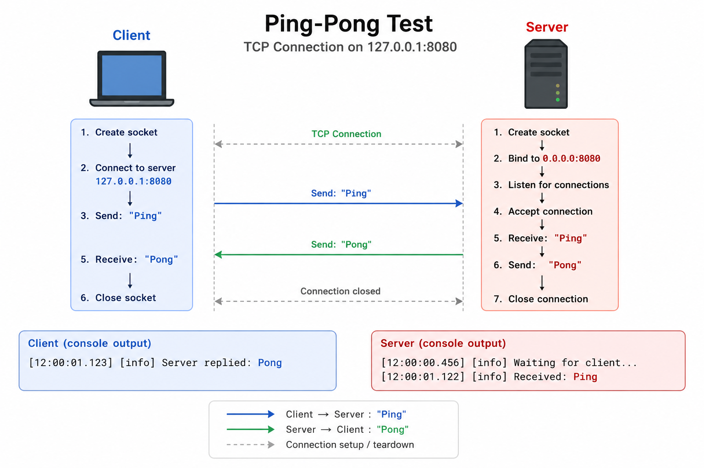

# Lesson 1: Ping Pong


## Premise 

I have never been a person that wanted to spend time teaching other how stuff works, but this year I fully realized the saying "You are only an expect in a subject if you can explain it in a way that a child could understand it".

I wanted to say this, that this project is not meant to be a big project with complex functionalities. This project is more about understanding the basics of networking so that we could explain it in a way that children could understand what we are doing.

Also, I decided to make these lessons, because I have another lessons that I started to do before networking. Those lessons are about rendering using OpenGL. While writing down those lessons, I observed the fact that what I thought was pretty "easy" is not that easy once I tried to explain it to others. That meant that I was not a specialist of that subject. But once I wrote down the first few lessons, I clearly noticed that I had better understand how basic things worked in redering.

With these lesson about rendering, I intend to teach myself about how networking using C++ works. With the word "myself" I imply also people that will be reading these lessons. 

In the end, I hope that I and you will be able to understand the building blocks of networking so that we could all explain it to the little kids.


## Ping Pong

In rendering there is a saying that everyone should start learning it by understanding and rendering a single triangle on a screen. In networking, most of the internet says that people should start learning it by creating a simple server / client program where a client can chat with a server and receive messages from server. 

This is all great, but for me, I found that to be too hard for me. That is why I have decided to go even deeper. This is where the ping pong test came to my mind. 

It is a very simple program which goal is to ping a server and receive the response if that server is running.

This program is pretty linear, with no loops or anything hard to understand. The only hard parts in this lesson are the basic concepts of networking which, currently, we do not understand.

So, without further adu, let's dive into the code and understand everything to become specialists.


## Program

In networking, almost always there are 2 types of roles for the programs:

1. **Server** - program that is dealing with client requests
2. **Client** - program that sends requests to the server

The idea that you need to have a server and a client, but, there can be many different servers and many different client implementations. For example, one server might only be responsible for temperature, meaning that if a client connects, this server immediately sends the current weather temperature, another server might be a chatroom where clients can connect and communicate with each other. Same idea goes with clients also. One client could work as some sort of a notification medium which can ping the temperature server to receive the temperature, the other client want to connect and communicate with other clients so it will connect to the chatroom server and etc..

In order to have a valid ping pong logic, we need to have 2 programs: srver and client.


### Note!!!

Before we begin, I just wanted to express, that some lines of the code will not be explained due to the fact that the line is clear or intuitive.

Server code:

```C++
#include "spdlog/spdlog.h"

#include <arpa/inet.h>
#include <unistd.h>


constexpr int PORT = 8080;
constexpr std::string_view HOST = "127.0.0.1";


int main()
{
    int server_socket = socket(AF_INET, SOCK_STREAM, 0);

    sockaddr_in server_addr{};
    server_addr.sin_family = AF_INET;
    server_addr.sin_port = htons(PORT);

    // Listen only on localhost
    inet_pton(AF_INET, HOST.data(), &server_addr.sin_addr);

    bind(server_socket, (sockaddr*)&server_addr, sizeof(server_addr));
    listen(server_socket, 1);

    spdlog::info("Waiting for client...");

    sockaddr_in client_addr{};
    socklen_t client_len = sizeof(client_addr);

    int client_socket = accept(server_socket, (sockaddr*)&client_addr, &client_len);

    char buffer[1024]{};

    recv(client_socket, buffer, sizeof(buffer), 0);

    spdlog::info("Received: {}", buffer);

    const char* reply = "Pong";

    send(client_socket, reply, strlen(reply) + 1, 0);

    close(client_socket);
    close(server_socket);

    return 0;
}
```

Client code:

```C++
#include "spdlog/spdlog.h"

#include <arpa/inet.h>
#include <string_view>
#include <unistd.h>


constexpr int PORT = 8080;
constexpr std::string_view HOST = "127.0.0.1";


int main()
{
    int socket_fd = socket(AF_INET, SOCK_STREAM, 0);

    sockaddr_in server_addr{};
    server_addr.sin_family = AF_INET;
    server_addr.sin_port = htons(PORT);

    inet_pton(AF_INET, HOST.data(), &server_addr.sin_addr);

    connect(socket_fd, (sockaddr*)&server_addr, sizeof(server_addr));

    const char* message = "Ping";

    send(socket_fd, message, strlen(message) + 1, 0);

    char buffer[1024]{};

    recv(socket_fd, buffer, sizeof(buffer), 0);

    spdlog::info("Server replied: {}", buffer);

    close(socket_fd);

    return 0;
}
```

If you struggle to visually understand this program, I hope this image will help you:




### Server code

Let's first analyze the server code, because without it, the concept of clients kind of does not make any sense.


#### Includes

`#include "spdlog/spdlog.h"` a simple logging tool. We will never use `std::cout` since spdlog is many times better.

`#include <arpa/inet.h>` library provides internet address manipulation functions. What these are will be explained in later sections.

`#include <unistd.h>` library that provides access to OS services such as:

* File operations:
    
    * `read()`
    * `write()`
    * `close()`

* Process management:
    
    * `forc()`
    * `exec()`
    * `getpid()`

* Sleeping:

    * `sleep()`
    * `usleep()`

* Pipes:

    * `pipe()`

* File descritor operations:

    * `dup()`
    * `dup2()`

Whether we will need these operations later, I do not know, but I still, I felt the need to write them down...


#### IP, Port and Socket

Some of the biggest concepts in networking in general. I mean, without understanding these 3 meanings, going forward, at least in TCP networking, is going to be really hard. So, what do they mean?

**IP** - stands for Internet Protocol. Most of the connected devices to a network have at least 1 IP address.. Why do devices need it? 

The main idea is that we want to have some ability to distinguish on the network which device is which. Imagine that there is a server (right now do now overthink about what it is, and imagine it like a simple box that clients can connect to) that is an actual chatroom, where clients can connect to and text with each other. If client A sends a message dedicated to client B, how can a server know how to make it so that only the client B would receive and not others? This is where the IP comes into play.

If a client has an IP, now it can be distinguished from that 100 different clients. IP is essentailly like an ID, which allows network to identify devices.

First of all, IP is just a simple number. It's format is this: XXX.XXX.XXX.XXX. A common example of a real IP address: 192.168.1.1. Let's understand, why IP has the format the way it has.

Computers do not think about IP addresses the same way we look at them. For computers, IP is a 32 bit number that is comprised of 0s and 1s. Again, for example, 192.168.1.1 IP address is for one device, 192.168.1.2 is for another device, 200.200.200.200 is for some other device. Because there are 32 bit, in total there are $2^{32} = 4,294,967,295$ different possible IP addresses. 

You might ask "Why only something over 4.2 billion addresses, aren't there more unique devices now?". Well, the answer is yes, but in the 1970s, when computer networking was literally in the child stage, engineers thought that 32 bits will be enough for all the devices that will ever to be. Or they were like "we do not have time to think about it, let's leave for future generations to solve...". Just to make you feel safer, now, there is a 128 bit address, but we will talk about it in the later lessons.

Going back to the IP format. Remember how I said that computers see IP addresses in binary, let's see how it sees some random IP address:

$
    192.168.1.42 = 11000000.10101000.00000001.00101010
$

To better understand it, let's display the same stuff vertically:

$
    \begin{aligned}
        192 & = 11000000 \\
        168 & = 10101000 \\
        1 & = 00000001 \\
        42 & = 00101010
    \end{aligned}
$

PS. to know how to convert binary to decimal, just watch [this simple YouTube short](https://www.youtube.com/shorts/HRfpUqWn7rs). For slightly longer explanations:

* [Binary to Decimal](https://www.youtube.com/watch?v=VLflTjd3lWA&list=PL0o_zxa4K1BXCpQbUdf0htZE8SS0PYjy-)
* [Decimal to Binary](https://www.youtube.com/watch?v=rsxT4FfRBaM)

As you can see, this IP address can be seen as 4 groups (sections) of 8 bit. 8 bits comprise a single **byte** (or octet in networking). So IP address can be seen as a group (section) of 4 bytes.

Why use dots to separate this 32 bit number into 4 different 8 bit numbers. The answer is because it was only desgned this way so that we could easier interpret it. There is no hidden reason behind, only that it is easier for us. For computers, it does not matter, the computers always sees IP addresses as a 32 bit number. The formating is just for us. 

n the previous example I showed how this number 192.168.1.42 looks in binary, but what if every section was all 1s? If a section of 8 bits is all 1s, the number is going to be equal to 255, the largest number that can be comprised of 8 bits. If our 32 bit IP address was all 1s, then the IP would be 255.255.255.255, if it is all 0s, then it is 0.0.0.0.

For now I think that is enough to know about the IP address for this lesson. What I want you to understand is that IP is just a simple number comprised of 32 bits.

**Port** is a logical communication endpoint used by the transport layer (such as TCP or UDP (I will explain what they are later)) to identify a specific program on a service running on a device.

A grea analogy for IPs and ports is imagine a street with apartment buildings. Each building has a unique number assigned to it so that a building could be identified on the stree. Also, each apartment in a given building has a unique number so that it could be identified in that building. In this analogy, the building number is the IP and the apartment number is the port:

| Networking Concept | Real-World Analogy | Purpose |
|--------------------|--------------------|---------|
| **IP Address** | Building address (e.g., 123 Main St.) | Identifies the destination device (building) on the network. |
| **Port** | Apartment number (e.g., Apt. 12) | Identifies the specific application or service (apartment) within the device. |
| **IP + Port** | Full address: 123 Main St., Apt. 12 | Identifies the exact communication endpoint (application on a device). |

There can be a total of 65536 TCP ports and additional 65536 UDP ports (again, we will talk about them later).

We need ports, because a single device might have multiple running applications, so if you want to target a specific application you would need to know a port to it. For example port 10,000 might be an endpoint to service that given 2 numbers outputs their sum, port 10,001 is a service that that deletes all your harddrive data (I hope you will not create a program like that...).

With ports we have a way to reach running programs or services on a device, given that they have are listening (have opened) the corresponding ports.

You might ask "what is an open port?". An open port is a network port which the running application is actively listening for incoming connections. An even simpler explanation is that a port becomes open when a program tells the OS that "I am listening on this port, send incoming connection to me".

Another analogy is that if a house is an IP, then all the ways you can get inside that house are ports (front / back doors, windows, garage and etc.).

```C++
constexpr int PORT = 8080;
constexpr std::string_view HOST = "127.0.0.1";
```

I decided to make them constants for this program, because during it's lifetime, these 2 values are not going to change.


The last concept that is the integral part in a lot of networking is socket.

**Socket** is an object created by the OS that represents one endpoint of a network connection. When I first read this definition, I still was not able to understand the meaning of a socket, but once I read a telephone example I clearly got it. To be honest, this will be a telephone + apartment building example.

The idea is this. Imagine that there are N apartment buildings with M apartments in each building. The are people living in apartments. So each person can be identified with a building ID (street name + building nr.) and an apartment number. There is a special telephone made for these buildings, where instead of normal numbers, you just enter the building ID and an apartment number. So if a person A, that is living in a building 10 and apartment 5, wants to call a person B that is living in building 4 and apartment 17, then the person A will have to dial 4.17 number into his phone. Person B sees that a number 10.5 is calling and answers the phone. This way people can call each other that live in these buildings.

In this example:

| Networking Concept | Apartment Analogy |
| ------------------ | ----------------- |
| **IP Address** | The **building ID** (street + building number). Identifies which building the communication should be delivered to. |
| **Port** | The **apartment number**. Identifies which apartment (application (in this example a person)) inside the building should receive the communication. |
| **Socket** | The **telephone inside the apartment**. It is the communication endpoint used to make and receive calls (network messages). |
| **Application** | The **person living in the apartment**. The application processes the received data and generates responses. |

The communication flow can be visualized as:

```text
Person A
(Building 10, Apartment 5)
        │
    Telephone (Socket)
        │
        ▼
     Dial 4.17
        │
        ▼
Building 4 (IP Address)
        │
Apartment 17 (Port)
        │
Telephone (Socket)
        │
        ▼
Person B (Application)
```

Now we know what all 3 major concepts mean in TCP networking. But just to glide by it one more time:

| Networking Concept | Meaning |
| ------------------ | ------- |
| **IP Address** | A unique 32-bit number assigned to a device on an IPv4 network. It identifies the destination device for network communication. |
| **Port** | A 16-bit number (0–65535) that identifies a specific application or service running on a device. A port is considered **open** when an application is actively listening on it. |
| **Socket** | An operating system object that represents one endpoint of a network communication channel. Applications use sockets to send and receive network data. |

Socket is created using this:

```C++
int server_socket = socket(AF_INET, SOCK_STREAM, 0);
```

Notice that the `server_socket` is an integer. It is because this function returns a descriptor that is essentially an ID to an actual object created somewhere else. For those that have read my opengl lessons, it is very similar to the way that many OpenGL objects or functions are accessable via the integer ID because that ID refers to that to that specific object that is managed internally by OpenGL. Same is here with a `server_socket` that is an ID to an actual object managet internally by OS.

`AF_INET` tells that we want a socket that is of type IPv4. Remember that there is also IPv6.

`SOCK_STREAM` tells that we want a TCP type of communication. Remember that there is also UDP (also, we will talk about it in later lessons).

`0` tells which protocol to use. A protocol is a simple set of rules that 2 devices agree to use when communicating. Different protocols define different rules. For TCP connection we almost always use `0`.


#### Server Logic

```C++
sockaddr_in server_addr{};
server_addr.sin_family = AF_INET;
server_addr.sin_port = htons(PORT);
```

These lines create a C (language) struct that essentially stores and IPv4 socket address. `sockaddr_in server_addr{};` initializes this struct to default values. `server_addr.sin_family = AF_INET;` tells that this socket address should be IPv4.

`server_addr.sin_port = htons(PORT);` this sets the socket address port. But what does `htons()` do?

`htons()` means **Host TO Network Short**. This function converts 16-bit integer (in C++ it is of type `short`) to a network byte order. Why can't we do simply `server_addr.sin_port = PORT;`? It all comes down to a to this concept of little-endian and big-endian. You can read about this concept [here](https://saliktariq.medium.com/big-endian-and-little-endian-systems-in-c-significance-code-differences-and-performance-487752a20496). In short, the idea behind it is that most of the computers nowadays store bytes using the little-endian format, while network protocols use big-endian format. Why network protocols use big-endian? It was also a design choice in the beginning of network programming. Just know that network protocols use big-endian when defining a port.

These 3 lines are pretty clear what they mean now, but I still had one question when learning this. What is the `sin` prefix in `sin_family` and `sin_port`? I do not know why they needed to add this prefix in the first place, but in is the abbreviation of **socket internet**.

```C++
inet_pton(AF_INET, HOST.data(), &server_addr.sin_addr);
```

This line converts the human readable IP address into the binary format that the OS could understand. So basically this:

```C++
"127.0.0.1"
```

is converted into:

```C++
01111111 00000000 00000000 00000001
```

and we assign the convertes result to `server_addr.sin_addr` variable. `AF_INET` tells that this address should be converted to IPv4 format.


#### Binding

```C++
bind(server_socket, (sockaddr*)&server_addr, sizeof(server_addr));
```

Before I give you the explanation on what is binding, I will take a step back and ask you: what do we have now?

Right now we have a socket descriptor `server_socket` that is just a simple number and `server_addr` struct that is containing necessary configuration information for our socket. The problem is that these 2 variables are not "connected" to each other. As of now we have a socket and a configuration as 2 separate things.

Now, our current socket looks like this:

```
--------------
|            |
| TCP socket |
| No address |
|            |
-------------
```

What we want is this:

```
-----------------
|               |
| TCP socket    |
| IP: 127.0.0.1 |
| Port: 8080    |
|               |
-----------------
```

What `bind()` does is exactly this. It associates the created socket with a defined IP address and a port. It kind of connects `server_addr` info with `server_socket`.

I remember that when I was learning this I had this question: "Why `socket(AF_INET, SOCK_STREAM, 0);` functionality does not allow setting port and ip to the created socket descriptor?". The idea is that because with this line:

```C++
int server_socket = socket(AF_INET, SOCK_STREAM, 0);
```

a socket is created that only knows 3 things:

* Address family: IPv4 (AF_INET)
* Type: TCP (SOCK_STREAM)
* Protocol: TCP

These 3 things are stored somewhere as a single separate concept managed by OS. More precisely OS creates a kernel object that knows only those 3 aforementioned things. You only have a single descriptor ID that associates it with a real kernel object (I will explain what a kernel is soon). But this:

```C++
sockaddr_in server_addr{};
server_addr.sin_family = AF_INET;
server_addr.sin_port = htons(PORT);
```

is a different concept, that deals with ports and IPs. You combine them with `bind()` to tell the OS to "Associate this with this.", and that's it. Do not overthink too much about this.

Up to this point we have a proper set up socket that is ready to be used. Let's learn how to use it.


#### Listening

```C++
listen(server_socket, 1);
```

This line tells to OS that this socket `server_socket` is a server socket and because of it, start listening for incoming connections. 

Before this line was called, our socket was just a simple TCP endpoint. But this endopoint still does not have a purposeful reason on why it exists. `listen()` is the function that makes our socket capable of listening for incoming clients, meaning that now, our socket is has a purpose. 

This funciton does not create a separate thread or repeatedly check for connection. It tells the kernel that if a new connections arrives on this socket, queue them until my program processes them further.

The kernel object is the real heavy lifter here, because it internally does all of the work like:

* receiving TCP SYN packets (will talk more about them in the future lessons)
* completing the TCP handshake
* maintaining a queue of pending connecitons

Our server program does not have to think about these operations, that is why it is great that we have only a descriptor, you do not have to think about all the under the hood stuff.

What does `1` mean? It is a simple backlog essentially telling how many connections are pending. If it is set to 1, then there can only be a single pending connection. Any more clients trying to connect are not guaranteed to succeed. The outcome depends on the OS and how the TCP is set up on that OS. Any more connections than the backlog might:

* timeout
* connection might be refused
* the client may retry automatically

all of these and others are possible, but it is the OS that decides what's going to happen next with that connection.

Also, notice one thing, `listen()` is not a blocking operation, meaning that the code following this function will be executed right after this function completes it's job. This function completes the job really fast, because it essentially is just a call to the kernel object "put this socket into a listening mode".


#### Accepting a client

```C++
sockaddr_in client_addr{};
socklen_t client_len = sizeof(client_addr);

int client_socket = accept(server_socket, (sockaddr*)&client_addr, &client_len);
```

In order to accept a client we first need create an uninitialized `sockaddr_in` struct. Remember that this struct stores IP address (IPv4 or IPv6) and port (everything that we need to know about the client). We need this struct to store information about connected client.

Before accept, `client_address` looks like this:

* IP Address: -
* Port: -

After the `accept()` the `client_address` might look like this:

* IP Address: XXX.XXX.XXX.XXX (remember, that this is actually a 32bit number)
* Port: XXXXX


```C++
socklen_t client_len = sizeof(client_addr);
```

This line, at first, I did not understand. This line tells to the kernel that the buffer size of the `client_addr` is `sizeof(client_addr)`. In C++, `sizeof()` returns the size of an object or a struct in bytes. We need to know the size because of the way we use `client_addr` in `accept()` function. This is because `accept()` receives a pointer to the client buffer and pointers do not bring with themselves information about the size.

I also had a question: "Why do we need to pass the size, when we can just have this function: `int accept(int sockfd, sockaddr_in* addr);`?". After some additional reading I understood that this is because mainly of 2 reasons:

1) When sockets were desgined, the idea was that there should be a single function that can take any information about incoming clients. Meaning that the client could be using Ipv4 or Ipv6 (in old times people did not think abput Ipv6). Socket API was designed in such way to support many addresses families. There can be many different client configurations that use IPv4, IPv6, Unix sockets, raw ethernet.
2) Because the sockets are written in C language, they have one drawback: functions in C cannot be overloaded. Meaning a function with a name X cannot be overloaded with different signatures like different arguments cound, or different return type.

If both of these were designed a bit different, maybe then you could have this:

* `int accept(int sockfd, sockaddr_in* addr);` 
* `int accept(int sockfd, sockaddr_in6* addr);` 
* `int accept(int sockfd, sockaddr_un* addr);` 
* `int accept(int sockfd, sockaddr_ll* addr);`


I hope that I gave you a proper explanation about why sockets need to know the sizes. Now let's move towards accepting the client.

```C++
int client_socket = accept(server_socket, (sockaddr*)&client_addr, &client_len);
```

This is the place that essentially is telling the kernel to wait for the client connection. This is the first blocking operation of our program, meaning that until a client will try to connect to this server, any code below this line is not going to be executed.

How does it work. Well, first, let's look at the arguments:

* `server_socket` tells which socket to use for listening (which kernel program to use).
* `(sockaddr*)&client_addr` a pointer to the client address. Once the connection comes, all the information about the client will be stored in this variable.
* `&client_len` as mentioned before, we need to know the size of the incoming client to correctly populate the client address buffer.

Notice, that `accept()` returns another socket descriptor. This time, this socket descriptor `client_socket` is representing a client. So now, we have 2 different sockets:

1. `server_socket` representing the server side
2. `client_socket` representing the client side

If we went back to the street and apartment buildings communication analogy, we would be at a place where a server (a person living in an apartment that is set up as a server) is listening through a phone for any connections, and if it hears any client it accepts and processes it. 

The final question I have about `listen()` and `accept()` was: "In general, what is the difference between these 2?". To put it simply, `listen()` tells to the kernel: "hey, start listening, do not think about what to do if a client tries to connect, but just listen". While 'accept()` is the place where you actually start dealing with a client, once the client (or anything else) tries to connect. This is one of the reasons why `accept()` is blocking. The application is waiting (listening) until anything tries to connect.

To put it short:

```
------------
|          |
| listen() |  --> start listening, but do not do anything else
|          |
------------

------------
|          |
| accept() |  --> if anyone tries to connect, start processing
|          |
------------

```


#### Dealing with a Client

We started listening, and are waiting for anyone to connect. Let's see what we do after someone tries to connect.

```C++
char buffer[1024]{};
recv(client_socket, buffer, sizeof(buffer), 0);
```

This is how we "process" the client once it connects. 

Initially we need to create a buffer that could store the information the client sends. We create an emtpy buffer (by using default initialization `{}`) that at first looks like this:

```
buffer
+----+----+----+----+-----+
|  0 |  0 |  0 |  0 | ... |
+----+----+----+----+-----+
```

Then we call `recv()`. Since we have a client socket's descriptor, we use it to tell the kernel "read data from this connected socket". That is, essentially, what the `recv()` does.

We store that read data into `buffer` object.

I noticed (at least for myself) that before moving any further, I think that right now the best thing to do, would be to analize how sockets work internally. So let's understand them properly before we move forward.


### Sockets (Intuition)

Let's get back to sockets, kernels and everything else related to this topic. At first, I think that we should analyze the kernel: what is it? 

The computer is organized something like this:

```
┌───────────────────────────────────────┐
│              User space               │
│                                       │
│  Chrome     Calculator   Your C++ app │
│                                       │
├───────────────────────────────────────┤
│                KERNEL                 │
│                                       │
│  Processes        Filesystem          │
│  Memory           TCP/IP networking   │
│  Drivers          Sockets             │
│                                       │
├───────────────────────────────────────┤
│              Hardware                 │
│                                       │
│  CPU     RAM     SSD     Network card │
└───────────────────────────────────────┘
```

You can kind of divide it into 3 parts, where each part is going deeper to the actual electricity, transistors and capacitors.


#### User Space

This is where the ordinary and every day programs live. Your browser, calculator, video games, video editors and etc. These programs can use CPU, GPU, RAM but in this space programs do not have an unrestricted access to all the aforementioned things. The main reason why user space exists is to isolate applications and programs to restrict them on what they can and cannot do so that they would not change or modify the protected parts of the system. More, about why the user space exits, will be explained later in this lesson.


#### Hardware

This is the physical part of the computer. CPU, GPU, keyboard, mouse, USB port, HDMI port, SSD card, RAM, motherboard, bits. 

If we went even deeper, you would see transistors, capacitors, inductors wires and etc.. All of the applications people use every day in the end are just electrical signals and bit states. Everything software does ultimately results in hardware performing physical operations like applying electrical current to a transistor to change a state of a bit.

In order to understand how sockets work, we do not need to go any deeper to understand how hardware works.


#### Kernel Space

I think that one of the ways to understand what this is, we have to start with an analogy.

Think of the whole computer as a human body. The hardware is the physical body:

```
eyes                ->      monitor
ears                ->      speakers
hands               ->      keyboard / mouse
short-term memory   ->      RAM
long-term memory    ->      SSD
nervous system      ->      buses / electrical connections
```

Now, imagine your thoughts or your conscience as programs (applications).

You probably would not want every random thought to have unrestricted control over your body. A thought existing in your mind does not mean that it will automatically make your body execute it. There are systems in place between your mind and body that controls what thoughts are executed and which are not. 

The same logic applies to applications. Imagine if you had a buggy calculator, that would for some reason make your CPU overheat and literally melt. That would make a lot of computers often go out of commission due to buggy or malicious applications. Or imagine that a video game would literally have an unrestricted access to all of you RAM (or GPU RAM). In this scenario the game could accidentaly override bits in RAM that literally control the state of your computer (or the state of GPU) and, for example, make your computer turn off, or delete some vital computer memory data.

Because of the reasons like this modern OS and CPU therefore provides mechanisms that isolate applications from one another and help protect important parts of the system.

Like the brain is the connector between the conscience and the body, you also can think kind of the same about the kernel. You can loosely think of the kernel as part of the brain and nervous system connecting the applications to the physical resources of the computer. Kernel managers and protects important resources such as memory, files, processes, networking and hardware devices.

An important thing to know is that when the application is running, not every operation requires the kernel to be called for help. Most of the application can be executed by the CPU itself, because most of the code probobly does not require privilged access to OS resources. 

Now, once I read about this, my initial thoughts were: "What is the priviledged access? How to know what is privileged and what is not? So when exactly is the kernel needed and when it's not?" 


#### User Space Privileged Access

First of all, a key thing to understand is that nothing in your application code can be executed freely without anyone's control. For example this code:

```C++

int main()
{
    int a = 5;
    int b = 11;
    int c = a + b;

    return 0;
}

```

if everything was executed without some sort of protection or control, one or more variables present in this program could crash or in any other way harm your computer. Why? Because here we have 3 INT type of variables. Ints are 32 bit. In memory, a single bit is the smallest physical unit of memory. Now imagine if you have some part of the memory that store bits vital to your computer performace. Any of the bits in this program could overwrite it and it could seriously harm your computer performance or even worse crash it. This is why something has to control what your program does. 

Remember how previously I said that all the operations performed by the application end up as pure hardware operations? Ultimately, software executes as CPU instructions and interacts with hardware state. However, this does not mean every hardware interaction requires kernel mode. User-mode programs can perform ordinary instructions and access their permitted memory directly. Certain operations—such as modifying page tables or directly controlling protected hardware—require privileged execution and therefore must be performed by the kernel.

To understnad better why priviliged rights are necessary, we first have to understand what path does a program take while it is being executed. Once a program starts to get executed, it follows this path:

```
C++ program
     │
     ▼
    CPU -----------------> Other hardware
     │           |         (GPU, SSD, network card,
     │           |         USB device, accelerator, etc.)
     │           ▼                      |
     │-----> does work <-----------------
                 │
                 │
                 ▼    
        Hardware operations     

```

First thing to know is that all programs are executed using CPU. In CPU itself there are more steps like compilation, but again, the goal of this lesson is not to give an intuition on how C++ works itself, but rather how networking works and what parts of hardware are responsible for what and why.

Every program starts by being executed by the CPU, but, for the aforementioned reasons (separation) not every program has the same amount of authority. This is one of the most important ideas for understanding priviliged rights and kernel.

There are 2 execution modes with different priviliged rights levels:

```
CPU execution
│
├── User mode
│   └── restricted privileges
│
└── Kernel mode
    └── much higher privileges
```

The CPU can execude code at different privilege levels. Ordinary applications execute in user mode, where certain operations are restricted. The kernel executes in kernel mode, where it has access to privileged operations that user mode programs cannot directly perform.

But, user mode still has some permissions:

```
User mode
├── add numbers                  ✓
├── modify CPU registers         ✓
├── read its permitted memory    ✓
├── write its permitted memory   ✓
├── call functions               ✓
├── execute branches             ✓
│
├── access kernel memory         ✗
├── change page tables directly  ✗
└── execute privileged CPU ops   ✗
```

At first, I kind of struggled with the idea that for some reason, some operations can be executed only in user mode, while others have to work in kernel mode? If kernel mode has stricter rules, then why doesn't all operation, no matter how simple they are, get executed in kernel mode?

The reason is that CPUs have predefined permissions, like the ones seen in the above diagram. If we take our simple C++ addition example with 3 integers, even though the variables are stored in memory, accessing them does not normally require entering kernel mode. The CPU executes the program in user mode and is allowed to access memory that belongs to the process. Hardware mechanisms such as virtual memory and the MMU enforce which memory the process is allowed to access.

The CPU can safely allow the program to execute a simple addition. There is essentially no security benefit by doing this:

```
Program
|
| "Kernel, can I add 2 numbers?"
|
▼
Kernel
|
| "Yes"
|
▼
CPU performs addition
```

The CPU provides hardware-enforced privilege levels. While executing in user mode, certain instructions and memory regions are inaccessible. The OS configures much of this protection, and the CPU enforces it while executing the program. If for every operation we asked the help of the kernel, it would add enormous overhead while protecting nothing useful. 

It is kind of like if before you ate anything, there was additional person that would constantly check what you can and what cannot eat. That is really inefficient, because you yourself can deduce what is safe and what is not to put inside your mouth. If, by any chance you encounter something suspicious or unknown, you can easily ask a specialist, if this is safe or not. The same way CPU knows what operations are safe to perform in user space and what need to directed to kernel space.

To some this section up, you can think that CPU draws a sanbox around your application with operations that can be executed in user space. Anything that requires privileged rights is directed to kernel space:

```
                USER MODE

     ┌──────────────────────────────┐
     │       Your C++ process       │
     │                              │
     │  CPU registers      ✓        │
     │  arithmetic         ✓        │
     │  its memory         ✓        │
     │  branches           ✓        │
     │  function calls     ✓        │
     │                              │
     └──────────────────────────────┘
                    │
            cannot freely cross
                    │
       ─────────────┼─────────────
                    │
                    ▼

     other processes' memory    ✗
     kernel memory              ✗
     arbitrary device control   ✗
     privileged CPU operations  ✗
```


#### Sockets and Kernel

So why did I bother to write additional sections about user space, kernel space and privileged rights? As mentioned before, we need to build an intuition on what sockets are in kernel space and I think that now it is time when we have enough knowledge to understand it.

A **socket** is not simply a C++ object or an integer in your application. The actual socket is an OS networking object managed by the kernel.

Going back to the code part, we were creating a socket as this:

```C++
int server_fd = socket(...);
```

At first glance it is a bit misleading, because it creates this intuition:

```
C++ application
|
|
-->int server_fd
        |
        --> socket
```

But this is not entirely and accurately what is happening. A better mental model is this:

```
            USER SPACE

        Your C++ application
       ┌───────────────────┐
       │                   │
       │     sock = 3      │
       │        │          │
       └────────┼──────────┘
                │
        descriptor / handle
                │
────────────────┼────────────────
                │
                ▼
              KERNEL

        ┌───────────────────┐
        │   socket object   │
        │                   │
        │ protocol state    │
        │ addresses         │
        │ buffers           │
        │ connection state  │
        │ ...               │
        └───────────────────┘
```

As mentioned before the interger that your program receives is not the socket itself, it is simply a file descriptor (a small identifier that lets a user to refer to the socket object itself).

The socket object lives in kernel memory (RAM) as kernel-managed data structures. The **network card`` is hardware that ultimately sends and receives network traffic.

Netork card (also called NIC (Network Interface Card)) - is the piece of hardware that lets your computer physically communicate with a network.

Because it is a physical object (hardware device), applications should not have access to directly control it, the kernel is responsible for managing access to it.

This distinction and understanding is very important.

Your application cannot simply take control of the network card and start transmitting arbitrary data through it whenever it wants to. As mentioned earlier, applications live in user space and have restricted priviliges, while the kernel manages the protected resources, such as network card.

So when your application wants to use network, the basic relationship between your app and the hardware looks like this:

```
Application
    │
    │ "I want a socket"
    ▼
Kernel
    │
    │ creates/manages socket
    ▼
Application receives a way
to refer to that socket
```

Later when your application wants to perform operations on the created socket, it asks the kernel again:

```
Your program
    │
    ├── socket()
    ├── bind()
    ├── listen()
    ├── accept()
    ├── connect()
    ├── send()
    ├── recv()
    └── close()
          │
          ▼
        Kernel
          │
          ▼
   networking subsystem
          │
          ▼
     network device
```

Why Should You Care About How Sockets Work in Kernel Space?

If you skipped the kernel side of the sockets, theoretically you could still continue with this lesson, but the problem of not understanding what sockets truly are would drastically slow down the learning for the later lessons.

For example, questions like:
1) Why does socket() return an integer?
2) Why can recv() block my program?
3) Where does received data wait before my program reads it?
4) How can data arrive when my program isn't currently executing recv()?
5) Why does the operating system know which application should receive an incoming packet?
6) What exactly does close() destroy?

would be many times harder to explain without knowing the kernel side of the sockets.

Before answering these, the final thing we need to learn about in depth are file descriptors:


#### File Descriptors

Because this number represents a file descriptor. Conceptually, your application process has something like a table maintained with the help of the kernel:

```
Your C++ application process

File descriptor table

0 ----> standard input
1 ----> standard output
2 ----> standard error
3 ----> socket
4 ----> some file
5 ----> another socket
```

When your program refers to the file descriptor with ID = 3, it means that particular open resource. You can think of resource as something that your program can access/use through the OS which is entirely managed by the kernel. The actual socket data structures are maintained by the kernel in kernel memory.

Also, if we want go deeper (actually we should), we have to understand what are file descriptors and what are the first 3 members of that list:

* standart input
* standart output
* standart error

All of these 3 are standart I/O streams. On Unix-like systems, the OS sets them up so they are accessable through file descripts `0`, `1`, `2`. Because these 3 file descriptors are resources, they are managed by the kernel.

If we want to have an even deeper understanding of file descriptors, we have understand how to use these 3 default resources (aka. file descriptors).

For a socket, we have this:

```C++
int socket_fd = socket(...);
```

For the 3 standart streams we already know what are their file descriptor values:

```
stdin  ----> 0
stdout ----> 1
stderr ----> 2
```

If you want to be an archaic cool person, you can use these 3 file descriptors like this:

```C++
#include <unistd.h>

int main()
{
    const char message[] = "Hello!\n";

    write(1, message, sizeof(message) - 1);
}
```

Don't remember that `1` in `write(1, message, sizeof(message) - 1);` is a stdout FD.

For these 3 FDs there are also symbolic constants already:

```C++
#include <unistd.h>

int main()
{
    const char message[] = "Hello!\n";

    write(STDOUT_FILENO, message, sizeof(message) - 1);
}
```

where:

```C++
STDIN_FILENO  == 0
STDOUT_FILENO == 1
STDERR_FILENO == 2
```

using this we can directly write into error stream:

```C++
#include <unistd.h>

int main()
{
    const char error[] = "Something went wrong!\n";

    write(STDERR_FILENO, error, sizeof(error) - 1);
}
```

And also we can read from file stream directly:

```C++
#include <unistd.h>

int main()
{
    char buffer[100];

    ssize_t bytes = read(STDIN_FILENO, buffer, sizeof(buffer));
}
```

In the last example, did you notice something very similar to what we have already used? It's the part:

```C++
read(STDIN_FILENO, buffer, 100);
```

It looks just like:

```C++
read(socket_fd, buffer, 100);
```

By default FDs `0`, `1`, `2` are kernel managed objects that point to the terminal. You can change that by calling your program like this:

```
./program 0< input.txt      - reads input from file
./program 1> output.txt     - outputs to a file
./program 2> errors.txt     - redirects errors to a file
```

I hope that now, you understand what a file descriptor is. Just to elaborate on it again, a **file descriptor** is a integer that indentifies a resource which is managed by the kernel.


#### Questions / Answers

I said that we can answer these questions:
1) Why does socket() return an integer?
2) Why can recv() block my program?
3) Where does received data wait before my program reads it?
4) How can data arrive when my program isn't currently executing recv()?
5) Why does the operating system know which application should receive an incoming packet?
6) What exactly does close() destroy?


**1) Why does socket() return an integer?** Because this integer is an ID for a file descriptor which is a resource managed by the kernel.

**2) Why can recv() block my program?** Suppose you did:

```C++
char buffer[1024];
recv(socket, buffer, sizeof(buffer), 0);
```

but nothing has arrived yet. The kernel sees this:

```
[ empty ]
```
but we asked the kernel to receive something. the kernel cannot return something that isn't there, so it waits until some data arrives. With normal blocking sockets, when we encounter this operation, the kernel, essentially, puts the main thread (the one that manages our C++ application) to sleep, until data arrives.

**3) Where does received data wait before my program reads it?** Received data lives in the kernel memory. Once you call:

```C++
recv(socket, buffer, sizeof(buffer), 0);
```

everything from the kernel memory is copied to the user space memory (aka. it is copied to `buffer`).

**4)How can data arrive when my program isn't currently executing `recv()`?** This is, probobly, the hardest conceptual leap in terms of understanding sockets and kernel. Our program does not directly receive bytes from the NIC directly, OS does.

NIC constantly is receiving bytes from the network, but it does not mean that our application is constantly getting those bytes. `recv()` does not mean "Start listening to the network right now", it is closer to "Give me the data the kernel is storing for this socket. If there is not any, wait according to the socket's blocking / nonblocking behavior (setup)".

The previous question / answer helps us with this question also. Because the NIC is constantly receving traffic, some of that traffic will be dedicated to the IP:Port that we use, which means that that traffic (the bytes) are dedicated to our program. But because those received bytes live in the kernel memory and because our application, that is in user space, cannot directly access the kernel space, we have to call `recv()` for it.

**5) Why does the operating system know which application should receive an incoming packet?** Because OS maintains networking data structure map that knows describes which traffic (data packets) are going to which sockets (one of those sockets is the one we created in this lesson).

**6) What exactly does close() destroy?** 

```C++
close(client_socket);
close(server_socket);
```

This operation tells OS that the process has finished using this (these) file descriptor(s). 

First of all, `close()` is not specific to sockets, it is a C++ function which tells the CPU that the operation using this file descriptor is finished. 

Remember this:

```
Your C++ application process

File descriptor table

0 ----> standard input
1 ----> standard output
2 ----> standard error
3 ----> socket
4 ----> some file
5 ----> another socket
```

`close()` could be used on any of these file descriptors and it would do exactly the same thing in this process scope.

Now, we have a situation where we have closed a file descriptor, but what happens to the socket in kernel space? Closing a file descriptor and destroying a socket in kernel space are 2 different things. 

For a simple application, where calling `close(socket)` is the last call to this socket, it triggers the kernel to start the termination process of that socket specified in `close(socket)` statement.

I won't go into the details of what happens tpo the socket in the kernel space, because currently I have not read about it and I do not think that this is a key thing to know for our simple ping-pomg application. Main thing to know that after calling `close(socket)` you should never try to do any operations with that file descriptor, because all of the resources of that resource (described by this file descriptor) are terminated.


#### Conclusion for Sockets and Kernel

The main things to understand about sockets and kernel are that in user space, we only have a file descriptor for a socket. All the real magic happens in the kernel space, because real socket objects and how data is assigned to which socket happens in NIC.